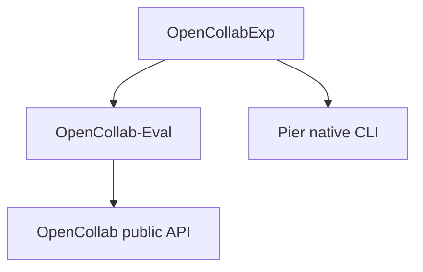

# Experiment layer architecture

OpenCollabExp owns the experiment layer around independent evaluation engines.
Its method selection, role configuration, campaigns, DW deployment, monitoring,
provider routing and report rendering depend on OpenCollab-Eval's evaluation
interfaces and Pier's native entry point. OpenCollab-Eval depends on OpenCollab's
public API for solver execution.

| Layer | Owned behavior | Selected interface |
| --- | --- | --- |
| Exp methods | Role graphs, instruction policies, method names, solver presets and experiment parameters | Explicit callable references and solver configuration |
| Exp orchestration | Campaigns, DW hosts, runtime deployment, queues, proxy configuration, monitoring and presentation | Experiment commands and caller-owned workspaces |
| OCE | Candidate construction, isolation, execution evidence, lifecycle, evaluation and official scoring | Generic workflow loader, evaluator API and native CLI |
| Pier | Native jobs, trials and the installed backend's evaluation behavior | Its own interpreter, CLI arguments and job configuration |
| OpenCollab | Agent, tool, environment and workflow execution primitives | Its documented public API |

The method registry in `opencollab_exp.methods` contains 31 workflows and the
review/fix method. Method names resolve to full callable references such as
`opencollab_exp.workflows.self_collab:self_collab`. The evaluation core loads the
selected reference through its generic loader. This runtime selection makes
experiment policy explicit while keeping the package dependency direction
from Exp to the evaluation engine.

`oc-exp methods` lists the complete callable registry. `oc-exp` provides a small
outer command dispatcher. Its experiment commands
retain their native argument parsers. `oc-exp run` selects `oce` or `pier`,
prepares a `BackendConfig`, and delegates to the process adapter. OCE is invoked
with `python -m opencollab_eval`. Pier is invoked with
`python -c 'from pier.cli.main import app; app()'`. An explicitly supplied module
uses `python -m MODULE`.

The process adapter passes the caller's argv list, cwd and environment directly
to the selected interpreter. OCE's generic `run` accepts a positional task JSONL.
Pier's native `run` accepts a job configuration. Native arguments and config
contents carry generation budgets, verification budgets and resource settings.
The adapter records the native exit code and appends stdout and stderr to the
experiment's selected artifact directory.

DW deployment settings belong to Exp's workspace and command configuration.
Host names, dataset roots, private provider settings, request limits, runtime
paths and remote artifact locations are supplied by the deployment owner.
OCE and Pier remain the selected execution and evaluation dependencies. Pier's
installed source distribution stays in its own environment.

Workspaces hold datasets, credentials, job files, predictions, trajectories,
logs and reports. The repository supplies the reusable code and portable
configuration examples. External workspaces are suitable for deployment;
repository-local `runs/`, `artifacts/`, `logs/` and `secrets/` are ignored options.
Development interpreters and tool caches live outside the source trees.

Candidate isolation, original target tests, evidence fields, process identity,
quiescence checks and credential protections stay with their existing execution
and scoring implementations. A zero native process exit means that invocation
completed successfully. Evaluation outcomes are determined from the native
candidate and scoring artifacts.

The companion OCE interfaces are developed on
`codex/extract-experiment-layer`, with its `main` branch retained. Development
installs OpenCollab, the companion OCE checkout and Exp as three editable
packages. Backend tests use a fake native CLI, while method tests load all
32 entries and exercise scripted workflows.

See [the root README](../README.md), [backend adapters](backends.md),
[method registry](methods.md) and [migration](migration.md) for concrete entry
points and installation details.
The [SWE Pro-Lite operations](swe-prolite-operations.md) guide covers DW setup
and deployment.
